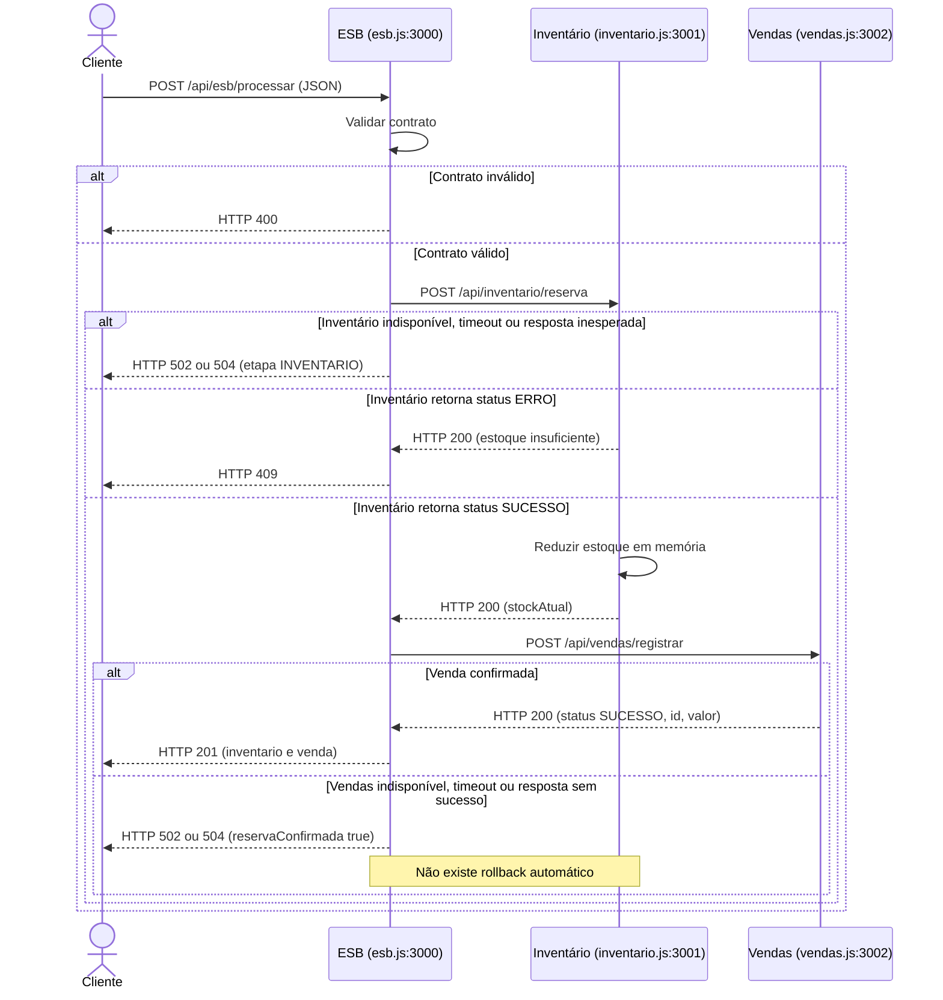

# Diagrama de sequência da implementação

O diagrama representa os arquivos e as rotas desta versão. Vendas não chama Inventário diretamente. Embora os legados usem HTTP 200, a confirmação depende também do campo `status` no corpo JSON.

Em uma falha de comunicação, a ausência de confirmação não prova ausência de efeito remoto. O booleano `reservaConfirmada` registra a confirmação recebida pelo ESB, não uma garantia de que nenhuma alteração ocorreu quando ele é falso.
