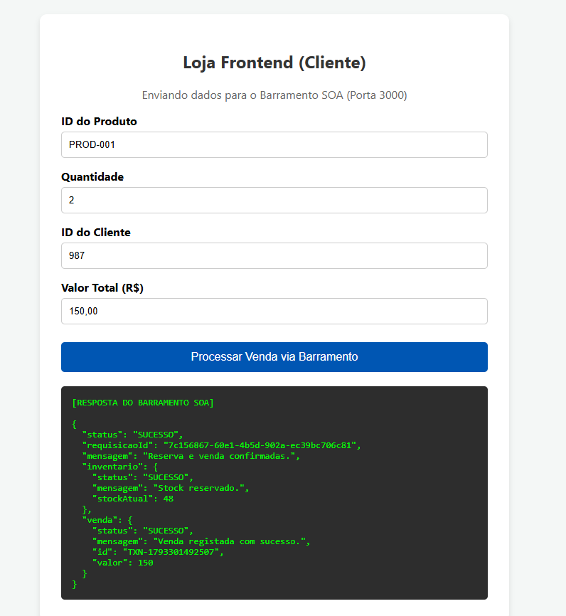
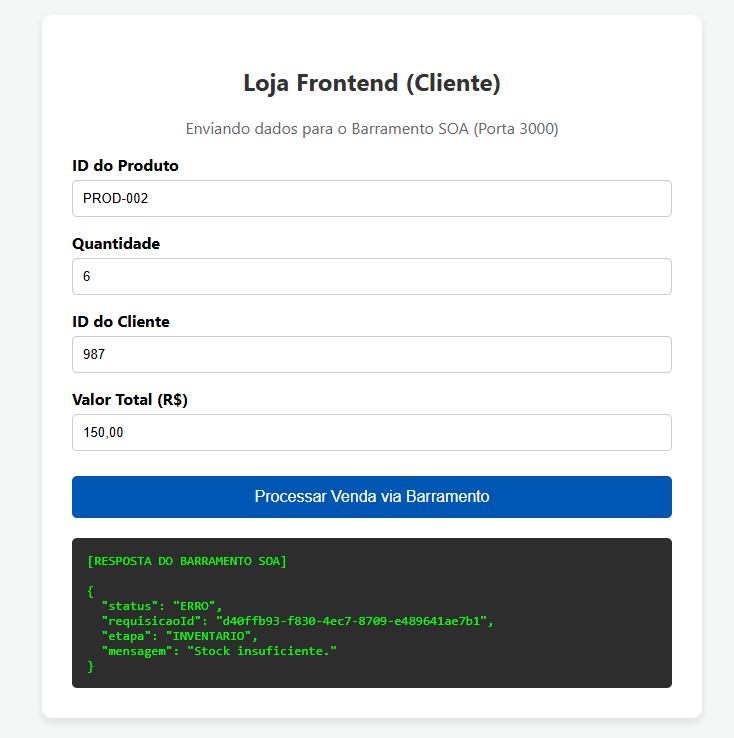

# Materiais para entrega — Projeto SOA/UCB

Esta pasta reúne os arquivos finais da apresentação e do relatório, além das evidências da PoC. Os arquivos estão disponíveis individualmente no GitHub; não é necessário baixar um ZIP.

## Entregáveis principais

- [Relatório técnico final em PDF](relatorio/Relatorio_Tecnico_SOA_UCB_Final.pdf) — inclui as evidências da execução no apêndice.
- [Apresentação em PowerPoint](apresentacao/SOA_UCB_Apresentacao_Com_Evidencias.pptx) — slides com as capturas dos cenários de sucesso e falha.
- [Guia para apresentar e ensaiar](apresentacao/Guia_de_Apresentacao_SOA_UCB.md) — roteiro, argumentos arquiteturais, perguntas prováveis e checklist.
- [Gravação da demonstração da PoC](video/Demonstracao_PoC_SOA.mp4) — vídeo de contingência da execução no navegador.

## Evidências da PoC

**Venda confirmada:** PROD-001, quantidade 2; reserva de estoque seguida do registro da venda.

**Estoque insuficiente:** PROD-002, quantidade 6; o ESB retorna o erro do Inventário e interrompe o fluxo antes de Vendas.

## Código e documentação complementar

- [Código da PoC e instruções para executar/testar](../README.md)
- [Metodologia e Desenvolvimento](../docs/semana3/metodologia-desenvolvimento.md)
- [Discussão dos Resultados](../docs/semana4/discussao-resultados.md)
- [Conclusão e Referências](../docs/semana4/conclusao-referencias.md)
- [Diagrama de sequência](../docs/diagramas/sequencia.md)

A implementação é uma PoC didática com serviços simulados em Node.js/Express e chamadas HTTP síncronas mediadas pelo ESB. Os limites da validação estão descritos no relatório e na documentação.